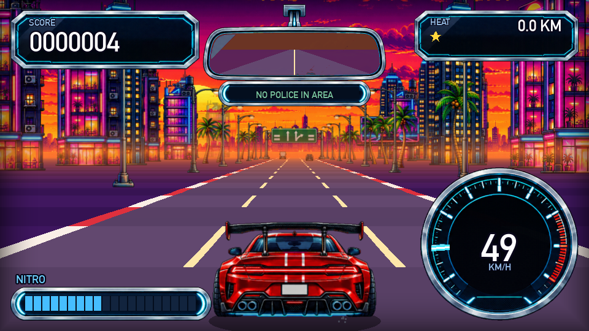
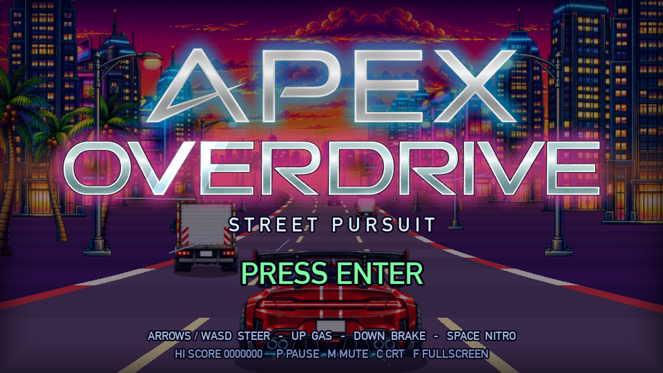

# APEX OVERDRIVE

[](https://github.com/skrehanahamed/Apex_Overdrive/actions/workflows/ci.yml)
[](https://github.com/skrehanahamed/Apex_Overdrive/actions/workflows/release.yml)
[](https://www.python.org/)
[](LICENSE)
[](https://pyga.me/)

A pseudo-3D retro arcade street racer featuring high-speed police pursuit, nitro boost, a functional rear-view mirror, procedural synthwave audio, and escalating heat levels. Built with Python and `pygame-ce`.



---

## Quick Start

### Prerequisites
- Python 3.10+
- `pip` / `make`

```bash
# Clone the repository
git clone git@github.com:skrehanahamed/Apex_Overdrive.git
cd Apex_Overdrive

# Run the game (automatically sets up virtual environment and installs dependencies)
make run

# Watch the AI autopilot drive
make bot

# Rebuild transparent sprites from raw sheets (optional)
make assets
```

### Manual Setup
```bash
python3 -m venv .venv
source .venv/bin/activate       # On Windows: .venv\Scripts\activate
pip install -r requirements.txt
python main.py
```

---

## Controls

| Key | Action | Details |
|:---|:---|:---|
| **Arrow Keys / WASD** | Steer, Gas, Brake | Full throttle builds distance from pursuers |
| **Space / Shift** | Nitro Boost | Extreme burst of speed to escape police pursuit |
| **P / Esc** | Pause | Toggle pause overlay |
| **M** | Mute | Toggle audio on/off |
| **C** | CRT Scanlines | Toggle retro arcade scanline simulation |
| **F** | Fullscreen | Toggle fullscreen display mode |
| **Enter** | Start / Retry | Launch race or retry after getting busted |

---

## Gameplay and Features

- **Police Pursuits & Heat Levels**: Start with an open highway before police cruisers initiate pursuit. Keep the distance bar away from BUSTED. Fill the bar to escape and advance the Heat level (faster cruisers, denser traffic, double roadblocks).
- **Near Misses & Nitro Refills**: Weave tightly through traffic lanes to score combo multipliers and replenish nitro. Blue canisters on the road provide instant refills.
- **Working Rear-View Mirror**: Live real-time rear-view mirror rendering police cruisers closing in behind you.
- **Procedural Synthwave Audio**: No external audio files. Multi-layered engine audio with gear shifts, tyre screeches, turbo spooling, police sirens, and procedural synthwave soundtrack synthesized on the fly via NumPy.
- **Dynamic Themes**: Four distinct visual biomes (Sunset, Midnight, Dawn, Vaporwave) with custom roadside dressings, billboards, and panoramic horizon backdrops.
- **Arcade CRT Filter**: Built-in post-processing CRT scanline simulation.



---

## Repository Layout

```text
Apex_Overdrive/
├── main.py               # Entry point (--bot, --shot out.png, --title)
├── apex/                 # Core game package
│   ├── world.py          # Physics, traffic AI, pursuit logic, pickups
│   ├── render.py         # Pseudo-3D road projection, backdrops, HUD
│   ├── track.py          # Track curves, hills, and theme definitions
│   ├── assets.py         # Sprite loading and world-scale dimensions
│   ├── audio.py          # Procedural audio and soundtrack synthesis
│   ├── font.py           # Pixel UI typography
│   └── game.py           # Fixed-timestep game loop and state management
├── assets/               # Extracted transparent sprites
├── sheets/               # Raw sprite sheets and horizon panoramas
├── brand/                # Logo and gameplay preview media
├── tools/                # Asset processing pipeline
├── ApexOverdrive.spec    # PyInstaller multiplatform build specification
└── .github/workflows/
    ├── ci.yml            # Multi-OS test matrix and headless smoke tests
    └── release.yml       # Standalone binary packaging and GitHub Release publisher
```

---

## Standalone Releases and Binaries

Pre-compiled standalone executables for Windows, Linux, and macOS are automatically generated on every release.

[View Releases on GitHub](https://github.com/skrehanahamed/Apex_Overdrive/releases)

| Platform | Package | Usage |
|:---|:---|:---|
| **Windows (x64)** | `apex-overdrive-windows-x64.zip` | Extract and run `ApexOverdrive.exe` |
| **Linux (x64)** | `apex-overdrive-linux-x64.tar.gz` | Extract and run `./ApexOverdrive` |
| **macOS (ARM/Intel)** | `apex-overdrive-macos-x64.zip` | Extract and run `./ApexOverdrive` |
| **Cross-Platform** | `apex-overdrive-source.zip` | Requires Python 3.10+ and `pip install -r requirements.txt` |

### Building Standalone Executables Locally
```bash
pip install pyinstaller
pyinstaller ApexOverdrive.spec --noconfirm
# Output binary will be in dist/ApexOverdrive/
```

---

## License

This project is licensed under the MIT License. See [LICENSE](LICENSE) for details.
